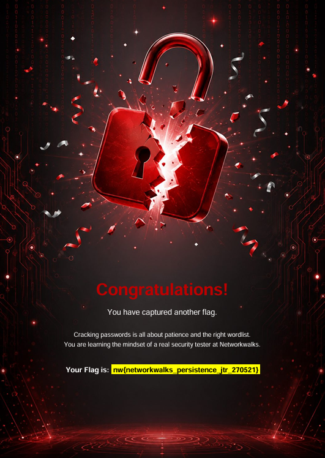
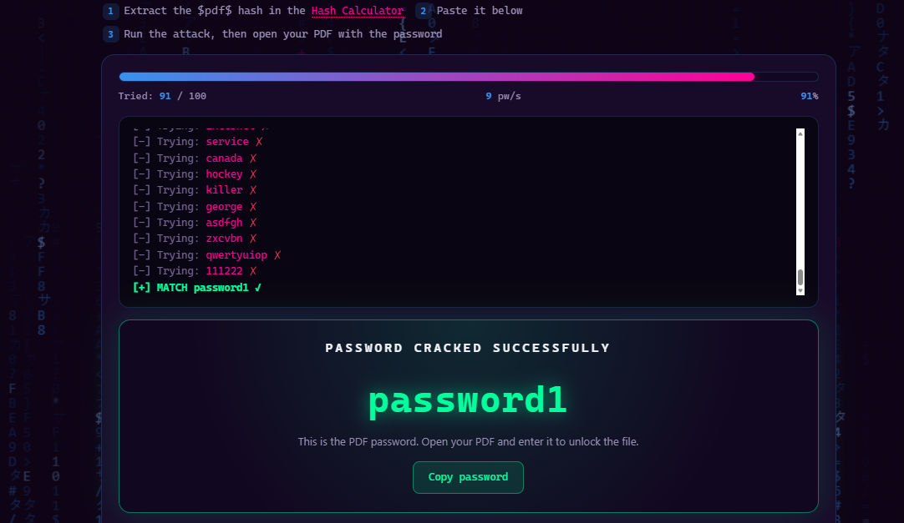

# NETWORKWALKS-RUSHDHA-B084K-WK3-PASSWORD-CRACKING
Networkwalks Cybersecurity &amp; Ethical Hacking Internship – Week 03: Password Cracking using John the Ripper (JTR), Johnny GUI, and Networkwalks Online Password Cracking Tools.

# NETWORKWALKS – WEEK 03
## Password Cracking | Cybersecurity & Ethical Hacking Internship

This repository documents the practical activities completed during **Week 03** of the Networkwalks Cybersecurity & Ethical Hacking Internship. The week's activities focused on understanding password security and recovering passwords from protected PDF documents using different password-cracking approaches.

Two practical modules were completed, exploring both a locally installed password-cracking tool and browser-based password-cracking tools provided by Networkwalks.

---

## Table of Contents

- [Project Overview](#project-overview)
- [Objectives](#objectives)
- [Tools and Technologies](#tools-and-technologies)
- [Project Module 01 – Password Cracking with John the Ripper](#project-module-01--password-cracking-with-john-the-ripper)
  - [1. Locating the John the Ripper Executable](#1-locating-the-john-the-ripper-executable)
  - [2. Extracting the PDF Password Hash](#2-extracting-the-pdf-password-hash)
  - [3. Saving the Extracted Hash](#3-saving-the-extracted-hash)
  - [4. Performing the Password-Cracking Attack](#4-performing-the-password-cracking-attack)
  - [5. Recovering the Password](#5-recovering-the-password)
  - [6. Verifying the Recovered Password](#6-verifying-the-recovered-password)
  - [7. Additional PDF Verification](#7-additional-pdf-verification)
- [Project Module 02 – Password Cracking with Networkwalks Tools](#project-module-02--password-cracking-with-networkwalks-tools)
  - [1. Extracting the PDF Hash](#1-extracting-the-pdf-hash)
  - [2. Using the Networkwalks Password Cracker](#2-using-the-networkwalks-password-cracker)
  - [3. Recovering the Password](#3-recovering-the-password)
  - [4. Verifying the Recovered Password](#4-verifying-the-recovered-password)
- [Key Learning Outcomes](#key-learning-outcomes)
- [Conclusion](#conclusion)

---

## Project Overview

Password cracking is a technique used in cybersecurity to evaluate password strength and identify weaknesses in password protection mechanisms. Security professionals use password-cracking tools during authorised security assessments to understand how easily weak or predictable passwords can be recovered.

During this week's practical activities, password-protected PDF documents were used to explore how password hashes can be extracted and analysed to recover their corresponding passwords.

The first module involved using **John the Ripper (JTR)** and its graphical interface, **Johnny**, while the second module explored Networkwalks' browser-based Hash Calculator and Password Cracker.

## Objectives

- Understand the fundamentals of password hashing and password cracking.
- Explore the purpose and functionality of John the Ripper.
- Understand the role of Johnny as a graphical interface for John the Ripper.
- Extract password hashes from protected PDF documents.
- Perform password-cracking attacks using different tools.
- Verify recovered passwords by opening the protected PDF documents.
- Understand the importance of strong passwords and secure password practices.

## Tools and Technologies

| Tool | Purpose |
|---|---|
| John the Ripper (JTR) | Password-cracking tool used to test password hashes. |
| Johnny GUI | Graphical interface for operating John the Ripper. |
| Networkwalks Hash Calculator | Browser-based tool used to extract password hashes from protected files. |
| Networkwalks Password Cracker | Online tool used to attempt password recovery from extracted hashes. |
| Windows PC | Operating environment for the practical exercises. |
| Web Browser | Used to access the Networkwalks online tools. |

---

# Project Module 01 – Password Cracking with John the Ripper

### Overview

The first practical module focused on recovering the password of a protected PDF document using John the Ripper and Johnny.

John the Ripper is an open-source password security auditing and recovery tool that supports various password hash formats. Johnny provides a graphical interface that simplifies interaction with the John the Ripper engine.

The practical involved extracting the PDF password hash, loading it into Johnny, performing a password-cracking attack and verifying the recovered password.

### 1. Locating the John the Ripper Executable

John the Ripper was downloaded and extracted on the Windows PC. The `john.exe` executable was located inside the `run` directory of the extracted package.

Johnny was configured to use the John the Ripper executable as its underlying password-cracking engine.

**Screenshot – John the Ripper Executable**

### 2. Extracting the PDF Password Hash

The password-protected PDF document was processed using a PDF hash extraction tool to obtain its password hash.

The extracted hash was in the PDF-specific format recognised by John the Ripper.

**Screenshot – Extracted PDF Hash**

### 3. Saving the Extracted Hash

The extracted hash value was copied into Notepad and saved as a text file named `hash1.txt`.

This file was prepared for loading into Johnny during the password-cracking process.

**Screenshot – Hash Saved in Notepad**

### 4. Performing the Password-Cracking Attack

Johnny was opened and the saved hash file was loaded using the **Open Password File** option.

A new password-cracking attack was initiated using the **Start New Attack** option. John the Ripper then attempted to identify the original password by testing possible password candidates against the extracted hash.

**Screenshot – Password-Cracking Attack**

### 5. Recovering the Password

The password-cracking process successfully identified the password associated with the protected PDF document.

The recovered result was displayed through the Johnny interface.

**Screenshot – Recovered Password**

### 6. Verifying the Recovered Password

The original protected PDF document was opened, and the recovered password was entered to unlock it.

The document opened successfully, confirming that the password recovery process was successful.

**Screenshot – Protected PDF Document**

**Screenshot – Successfully Unlocked PDF**

### 7. Additional PDF Verification

Additional PDF hash extraction and document verification were also carried out as part of the practical exercise.

The following screenshots document the additional PDF hash and successful document access.

**Screenshot – Additional PDF Hash**

**Screenshot – Additional PDF Unlocked**

**Screenshot – Further PDF Verification**

**Module 01 Result:** Successfully completed the password recovery exercise using John the Ripper and Johnny, with the recovered password verified by opening the protected PDF document.

---

# Project Module 02 – Password Cracking with Networkwalks Tools

### Overview

The second practical module explored password recovery using two browser-based tools developed by Networkwalks.

Unlike the previous module, this exercise did not require installing a dedicated password-cracking application. Instead, the PDF hash was extracted using the Networkwalks Hash Calculator and submitted to the Networkwalks Password Cracker.

The exercise demonstrated an alternative approach to password recovery through web-based security tools.

### 1. Extracting the PDF Hash

The Networkwalks Hash Calculator was accessed through a web browser.

The provided password-protected PDF document was uploaded to the tool, which processed the file and generated its corresponding PDF password hash.

The complete hash value was obtained for use in the next stage.

**Tool:** [Networkwalks Hash Calculator](https://networkwalks.com/hash-calculator/)

**Screenshot – Networkwalks Hash Calculator**

### 2. Using the Networkwalks Password Cracker

The Networkwalks Password Cracker was opened in a separate browser tab.

The extracted PDF hash was copied into the provided input field, and the password-cracking process was initiated.

The tool attempted to identify the original password by testing possible password candidates against the supplied hash.

**Tool:** [Networkwalks Password Cracker](https://networkwalks.com/password-cracker/)

**Screenshot – Networkwalks Password Cracker**

### 3. Recovering the Password

The password-cracking process completed successfully, and the recovered password was displayed by the Networkwalks Password Cracker.

**Screenshot – Successfully Recovered Password**

### 4. Verifying the Recovered Password

The protected PDF document was opened, and the recovered password was entered to unlock it.

The document opened successfully, confirming that the password recovery process was completed.

**Screenshot – Successfully Unlocked Document**

**Module 02 Result:** Successfully extracted the PDF password hash using the Networkwalks Hash Calculator, recovered the password using the Networkwalks Password Cracker and verified the result by opening the protected document.

---

## Key Learning Outcomes

Through these two practical modules, the following concepts and skills were explored:

- **Password Hashing:** Understood how passwords are represented using hash values and how these values can be used during password security assessments.
- **Hash Extraction:** Gained practical experience extracting password hashes from protected PDF documents.
- **John the Ripper:** Explored the functionality of an established password-cracking tool and its ability to work with different hash formats.
- **Johnny GUI:** Learned how to configure and use a graphical interface to perform password-cracking operations.
- **Online Password-Cracking Tools:** Gained experience using browser-based tools to extract hashes and attempt password recovery.
- **Password Security:** Observed how password complexity and predictability influence the difficulty of password recovery.
- **Practical Verification:** Verified recovered passwords by successfully opening the corresponding protected PDF documents.

## Conclusion

Week 03 provided practical exposure to password recovery techniques through two different approaches: locally installed password-cracking software and browser-based security tools.

By working with John the Ripper, Johnny and Networkwalks' online tools, the exercises demonstrated how password hashes can be extracted and used to evaluate password strength through authorised password-cracking techniques.

The practical activities strengthened my understanding of password hashing, password recovery methodologies and the importance of implementing strong, unique passwords to protect sensitive information.

---

### Ethical Use and Disclaimer

All activities documented in this repository were performed as part of the Networkwalks Cybersecurity & Ethical Hacking Internship for educational purposes using the provided practice materials.

Password-cracking techniques should only be performed on files and systems for which explicit permission has been granted.

**Repository:** [NETWORKWALKS-RUSHDHA-B084K-WK3-PASSWORD-CRACKING](https://github.com/rushdha-22/NETWORKWALKS-RUSHDHA-B084K-WK3-PASSWORD-CRACKING)
